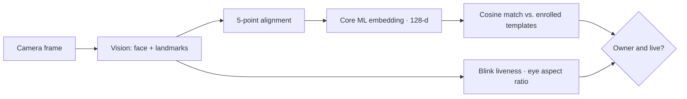

# FaceUnlock

<p>
  
  
  
</p>

> **Fully on-device face recognition for macOS, with liveness checks that reject photos. No network, ever.**

### Highlights
- **Complete recognition pipeline:** Apple Vision face and landmark detection → 5-point similarity alignment → 128-dimensional embedding from an SFace model running in Core ML → cosine matching against enrolled templates.
- **Liveness:** blink detection from the eye aspect ratio, so a printed photo or a phone screen doesn't pass.
- **Private by design:** camera frames never leave the Mac; the only third-party artifact is the model file, fetched once and checksum-verified.
- **Testable architecture:** pure math (alignment, matching, liveness) lives in `FaceUnlockCore` with XCTest coverage, separate from the camera and Vision layer.



---

An on-device face recognizer for macOS, in the menu bar.

FaceUnlock watches the built-in camera, recognizes its owner's face, and checks
that the face is a live person rather than a photo. Everything runs on the Mac and
the app makes no network connections.

**v1 does nothing when it recognizes you.** The whole recognition pipeline runs
end to end (detect → align → embed → match → liveness), and on a confirmed match
it updates the menu-bar status and stops there. The one place an action could
later attach is the `RecognitionAction` enum, whose only case today is
`.doNothing`.

## Layout

- `FaceUnlockCore` — pure, testable logic: the 5-point alignment transform, cosine
  matching, blink/eye-aspect-ratio liveness, the enrolled-template model, config.
- `FaceUnlockVision` — camera capture, Apple Vision detection, face alignment,
  the Core ML embedder, template storage, and the recognition engine.
- `FaceUnlock` — the menu-bar app: lifecycle, enrollment window, camera preview.

## Build and run

```bash
swift test                 # run the FaceUnlockCore unit tests
./scripts/build_app.sh     # build and sign FaceUnlock.app
open build/FaceUnlock.app  # a face icon appears in the menu bar
```

The app runs without the recognition model — it will detect faces and report
"model not installed." To make recognition work, add the model as described in
[docs/MODEL.md](docs/MODEL.md), which is the one step that fetches a third-party
file and so is done deliberately, with a checksum, after review.

## Requirements

Apple silicon Mac, macOS 26+, Xcode 27 / Swift 6.4.
